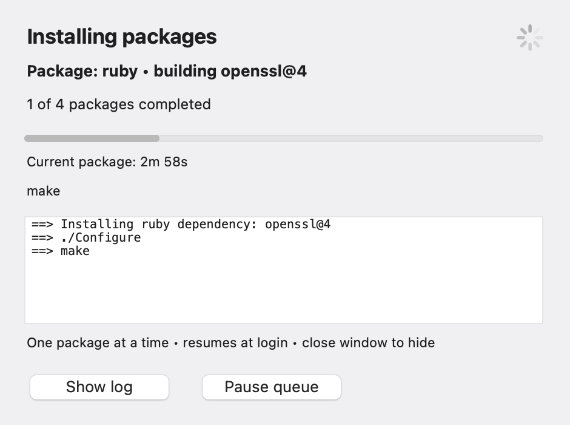
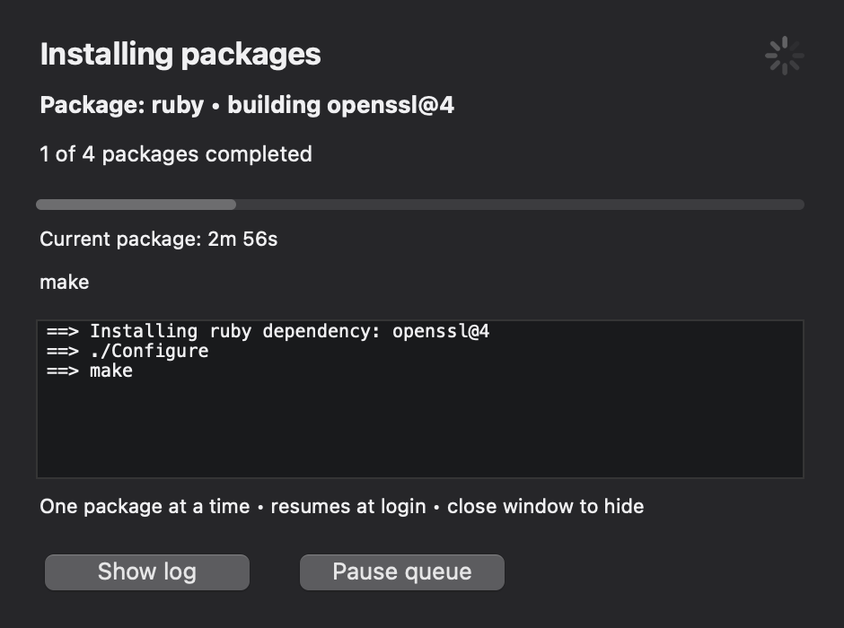

# Intel macOS installation and background builds

This guide covers Intel Macs, including a MacBookPro11,3 running Tahoe. The background queue and native status window are macOS-only additions. They do not add a Synology boot task or change the existing Synology install choices. Apple Silicon can optionally use the macOS background option, while its normal Homebrew bottle-based flow remains available.

## What changed for Intel Macs

As of October 2026, Homebrew has stopped producing new Intel macOS bottles. Existing compatible bottles may still work, but current formulas increasingly build from source. The planned removal of Intel runtime support in or after September 2027 is a separate, later change; it does not mean Intel bottles remain available until then. See [Homebrew's support policy](https://docs.brew.sh/Support-Tiers#future-macos-support).

The upstream installer also [removed Intel macOS support in September 2026](https://github.com/Homebrew/install/pull/1140). This project now:

- detects Intel macOS and selects official installer revision `0f5b7666a65fc2d1a2615549f02771353c250f9a`, retaining `/usr/local` bootstrap support
- reuses a working `yq` or downloads its verified official standalone binary before validating YAML, avoiding the Go/Pandoc/Haskell build chain for the parser
- skips blanket Homebrew upgrades on Intel macOS, while still attempting requested packages
- offers a resumable background package queue and floating status window so long builds do not occupy the installation terminal

The pinned revision applies only to the Homebrew bootstrap script. It does not freeze package versions, restore Intel bottles, or guarantee every current package will build. Git, Neovim and other Homebrew formulas can still need CMake and source compilation. A completed CMake installation is reused by later builds.

## Start on the MacBook itself

Update the checkout on the target Mac, then run the normal installer. Choose **3** to start background builds now, or **4** to finish Homebrew bootstrap and save the package queue paused for later:

```zsh
cd ~/Synology-Homebrew
git switch main
git pull --ff-only
bash ./install-synology-homebrew.sh
```

The LaunchAgents are created on that Mac, as its logged-in user. They are not installed remotely or on the computer used to maintain this repository. Do not run this as root.

If Homebrew is already installed, the queue can also be started separately from the repository:

```zsh
bash ./background-packages.sh start ./config.yaml
# Or save the queue without starting compilation:
bash ./background-packages.sh start ./config.yaml --paused
```

On a fresh Mac, use main installer option 3 or 4 first; the separate command expects the Homebrew executable to exist. The main installer bootstraps Homebrew before calling that command.

## Background package setup

On Intel or Apple Silicon macOS, options **3** and **4** provide the background package workflow. These options are macOS-only; the Synology flow is unchanged. Option **4** saves the queue paused and opens a **Resume** button: no queued formulas compile until you choose to start them. An already running formula finishes before an existing queue pauses. Homebrew bootstrap can finish separately, but the remaining tools and final configuration are still pending.

The foreground stage installs/verifies Homebrew, prepares the standalone YAML parser, adds Homebrew's shell environment to `~/.zprofile` without replacing existing content, and queues the baseline formulas plus the `install` formulas from `config.yaml`. It then releases temporary sudo access and returns your terminal. A user LaunchAgent installs one queued formula at a time with lower process priority and two build jobs by default. It does not run a blanket upgrade, uninstall packages, or retain sudo access.

A small native window stays above normal windows and shows:

- the current formula and recent dependency/build output
- elapsed time for the current formula and an animated activity indicator
- an overall progress bar based on completed formulas, not an estimated compile percentage
- retry timing and failures, with **Show log**, **Pause queue**, **Resume** and **Retry now** controls as appropriate

Closing the window hides it without stopping the worker. **Pause queue** lets the current formula finish before pausing. Formula failures do not skip later entries: the worker attempts the rest, then retries unfinished entries after delays from 5 up to 30 minutes. Build tools may still use substantial CPU, and not every build system honours the requested job count. For a different limit, launch the installer with, for example:

```zsh
SYNOBREW_BUILD_JOBS=1 bash ./install-synology-homebrew.sh
```

Progress, the config snapshot and a copy of the runner/window are saved under `~/.local/share/synology-homebrew/background`. A restart or logout interrupts the current build; at the next login, the worker and window reopen and resume unfinished work. Completed formulas are checked and skipped. Homebrew does not guarantee resuming inside a partially compiled formula, so that formula may rebuild. The Mac must be awake and the user logged in to make progress.

A queue deliberately paused with option 4 or **Pause queue** stays paused across logins until you choose **Resume**.

When the queue reports **Packages are ready**, choose **Finish setup…** in the window, or rerun the main installer and choose **2**, to apply shell, plugin and Neovim-provider configuration. When the saved config matches and all queued formulas are still installed, the installer reuses them and skips foreground baseline installs/upgrades. It also suppresses automatic package upgrades during this final configuration step. Package completion alone is not completion of the full environment. Keep `config.yaml` unchanged until that final step; changing it can request additional foreground installs instead of reusing the completed queue.

Useful commands, run from the repository:

```zsh
bash ./background-packages.sh status
bash ./background-packages.sh window  # reopen the floating window
bash ./background-packages.sh log     # follow output; Control+C only stops viewing
bash ./background-packages.sh pause   # pause after the current formula
bash ./background-packages.sh resume  # resume, or retry immediately during a wait
```

The LaunchAgents remain registered for future queues. Their workers exit when there is nothing to do; they do not poll or compile while idle. An existing completed queue is retained as history when option 3 creates a new one. To discard an unfinished queue without deleting installed packages, pause it, wait until paused, then run `bash ./background-packages.sh abandon` before creating a replacement.

If switching from an older foreground installation, stop that run with Control+C before starting option 3. Already installed Homebrew formulas are retained and reused; the formula interrupted during its build may need to restart. Do not run another Homebrew installation alongside an active queue.


## Status window





Illustrative window with sample package counts. The activity indicator animates during work; an individual compiler percentage is only available if the build itself reports one in its output. The window uses built-in macOS AppKit through JavaScript for Automation, so no GUI compiler, Python environment or browser server is required. Selecting text or scrolling back in the output pauses output following until you return to the bottom and clear the selection.

The panel and log follow the system appearance, including changes while the window is open. To update the appearance of an existing job after pulling a window fix, run `bash ./background-packages.sh window` from the updated repository. It refreshes only the saved window script and reopens the display; it does not replace the worker, reset package progress or interrupt compilation.

## LaunchAgent lifecycle and uninstall

The user agents are `com.mrcee.synology-homebrew.packages` and `com.mrcee.synology-homebrew.packages.status`, saved in `~/Library/LaunchAgents`. They run at login. There is no periodic idle timer or permanent compilation process after a queue finishes. The completed window can remain open for the final setup action, but its polling timer stops when the queue completes.

Leave the agents installed for future queues. To remove them manually, first pause the queue and wait until it reports paused, then run:

```zsh
bash ./background-packages.sh disable
```

This retains packages, checkpoints and logs; `resume` can register the agents again. The main uninstaller refuses to run while an unfinished queue exists. After that queue is abandoned, or when it is already complete, the uninstaller removes both agents before removing Homebrew.

## What restart recovery means

The queue saves a copy of `config.yaml`, its package list, completed-formula checkpoints and its runner/window scripts. At login it checks saved completions against installed formulas and retries unfinished work. It does not rely on the original terminal or on temporary sudo credentials. Pulling repository changes does not modify a running job's saved scripts or config; to replace that job, pause it, wait, abandon it and create a new queue. Already installed formulas are retained.

A whole-Mac reboot has not been exercised by the automated tests: recovery is tested with a saved running state, a stale worker lock and verified completed packages. Package installs and GUI callbacks are tested separately without installing real formulas or registering real LaunchAgents on the development machine. A full run on the target Mac is still needed to verify its particular packages and permissions.
